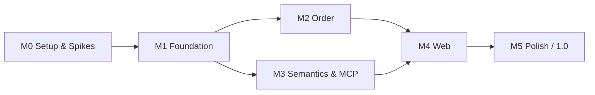

# Roadmap: `shelf`

| | |
|---|---|
| **Based on** | [PRD v1.0](prd.md) |
| **Status** | Draft |
| **Date** | 2026-10-12 |

---

## 1. Overview

The roadmap follows the milestones from PRD chapter 11 and adds a preparatory phase **M0**. M0 front-loads the technical spikes, so that risky decisions (Native AOT, native dependencies) are settled before feature work starts.

Each milestone ends with a usable state and a tagged pre-release.

| Phase | Goal | Pre-release | Acceptance criteria (PRD 12) |
|---|---|---|---|
| **M0 – Setup & Spikes** | Solution skeleton, CI, technical risks settled | – | – |
| **M1 – Foundation** | Import, grouping, full-text search via CLI | `v0.1.0` | 1, 3 |
| **M2 – Order** | Sorted, tagged library, exact duplicates | `v0.2.0` | 2 |
| **M3 – Semantics & MCP** | Semantic search, AI assistant access | `v0.3.0` | 4, 6 |
| **M4 – Web** | Web UI with reader | `v0.4.0` | 5 |
| **M5 – Polish** | Should items, release pipeline | `v1.0.0` | 7 (complete) |

M2 and M3 depend only on M1 and could be swapped or interleaved. M4 needs both, because the web UI covers tags, duplicates, and semantic search.

## 2. Development Process: BDD with Reqnroll

All features are developed behavior-driven with **Reqnroll**: feature files with examples come first, implementation second, and all scenarios must be green afterwards. The detailed rules are in [`CLAUDE.md`](../CLAUDE.md).

For the roadmap this means: M0 sets up Reqnroll and CI, and every milestone's exit criteria include a green BDD suite. CI blocks merges with failing scenarios.

## 3. Milestones

### M0 – Setup & Spikes

**Goal:** All technology decisions that are expensive to revise later are verified.

| Work package | Details | PRD reference |
|---|---|---|
| Solution skeleton | Projects as in 10.1, central package management, `Directory.Build.props`, nullable + warnings as errors | 10.1 |
| CI | Build + test for `osx-arm64`, `osx-x64`, `linux-x64`, `linux-arm64`; AOT publish as a CI job | 9.2 |
| BDD setup | Reqnroll test project `tests/Shelf.Specs`, choice of test runner, CI runs all scenarios and fails on red ones; first feature file as a template | `CLAUDE.md` |
| License and maintenance check | All candidates from 10.2; result documented as an ADR | 10.2 |
| **AOT spike** | One AOT binary that loads and uses: Microsoft.Data.Sqlite + FTS5, sqlite-vec, VersOne.Epub, PdfPig, ONNX Runtime, ModelContextProtocol SDK, ASP.NET Core Minimal APIs + RazorSlices, TOML parser | Q1, Q2, risk "Native AOT" |
| CLI framework decision | Spectre.Console.Cli vs. System.CommandLine, decided by AOT compatibility and cold start | 10.2, 7.1 |
| Cold start measurement | Baseline of the spike binary against the < 150 ms target | 9.1 |
| Test fixtures | Public-domain EPUBs/PDFs; generator for a synthetic library of 10,000 works / 15,000 files for performance tests | 10.1, 9.1 |
| Logging | Microsoft.Extensions.Logging to stderr only | 10.2 |

**Exit criteria:**

- The AOT spike runs on all four platforms, or every incompatible library has a documented fallback (ReadyToRun, Svelte instead of RazorSlices, brute-force cosine instead of sqlite-vec).
- CLI framework and TOML parser are chosen.
- Reqnroll runs in CI; the template feature file is green.

### M1 – Foundation

**Goal:** A library can be created, imported, grouped, and searched via the CLI.

| Area | Must | Should |
|---|---|---|
| Library and data model | F-LIB-1, F-LIB-2, F-LIB-4, F-LIB-5, F-LIB-6, F-LIB-7 | F-LIB-3 |
| Import and extraction | F-IMP-1, F-IMP-2, F-IMP-3 | F-IMP-4, F-IMP-7 |
| Grouping | F-GRP-1, F-GRP-2, F-GRP-3, F-GRP-4, F-GRP-6 | – |
| Search | F-SRC-1, F-SRC-2, F-SRC-3, F-SRC-5 | – |
| Configuration | Global and per-library `config.toml` (9.2) | – |

**CLI commands:** `init`, `import`, `scan`, `reindex`, `search`, `show`, `edit`, `merge`, `split`, `review`, `open`, `stats`. All with `--json`, exit codes 0/1/2, `NO_COLOR` (7.1).

**Notes:**

- The review queue (`.shelf/review.json`, F-IMP-7) is needed as early as M1, because F-GRP-3 (Must) creates review entries.
- `book.json` already uses the final schema from 10.4, including `files[].progress` and `notDuplicates`, so that no schema migration is needed later.
- The grouping thresholds (F-GRP-6) are calibrated against acceptance criterion 1 before M1 is closed.

**Exit criteria:**

- Feature files exist for all M1 requirements, and all BDD scenarios are green.
- Acceptance criteria 1 and 3 are met.
- Performance on the synthetic library: search p95 < 100 ms, incremental scan without changes < 3 s, initial indexing < 15 min, cold start < 150 ms.

### M2 – Order

**Goal:** The library is sorted by pattern, tagged, and free of exact duplicates.

| Area | Must | Should |
|---|---|---|
| Organization | F-ORG-1 to F-ORG-7 | F-ORG-8 |
| Tags | F-TAG-1 to F-TAG-5 | – |
| Duplicates | F-DUP-1, F-DUP-2, F-DUP-4, F-DUP-5 (CLI part) | F-DUP-6 |
| Grouping | – | F-GRP-5 |

**CLI commands:** `organize`, `undo`, `tag add|rm|list|rename|merge`, `dupes [--interactive]`, `trash empty`.

**Notes:**

- The journal (F-ORG-6) is used for all file operations, including moving files to the trash, so that crash recovery works (9.3).

**Exit criteria:**

- Feature files exist for all M2 requirements, and all BDD scenarios are green.
- Acceptance criterion 2 is met (organize + undo verified by hash comparison).
- No collision ever overwrites a file (F-ORG-7), covered by tests.

### M3 – Semantics & MCP

**Goal:** Semantic search runs locally, and an AI assistant can use the library via MCP.

| Area | Must | Should |
|---|---|---|
| Semantic search | F-SEM-1, F-SEM-2, F-SEM-3, F-SEM-4, F-SEM-7 | F-SEM-5, F-SEM-8 |
| Model handling | Model download to `.shelf/models/`, `shelf model install <path>` (9.2) | – |
| MCP server | stdio transport, tools `search_books`, `semantic_search`, `get_book`, `read_passage`, `list_tags`, `add_tags`, `remove_tags`, `find_duplicates`, `propose_organization`; resources `shelf://book/{id}` and `shelf://book/{id}/toc`; `mcp.readOnly` (7.2) | – |

**CLI commands:** `semantic`, `reindex --embeddings`, `model install`, `mcp`.

**Notes:**

- Embeddings are indexed at work level first, chunks afterwards (risk "Initial embedding indexing takes long").
- If sqlite-vec failed in M0, the brute-force cosine fallback in C# is used.

**Exit criteria:**

- Feature files exist for all M3 requirements, and all BDD scenarios are green.
- Acceptance criteria 4 and 6 are met.
- Semantic search p95: work level < 300 ms, chunk level < 800 ms.
- Initial embedding indexing of the synthetic library < 6 h and resumable.

### M4 – Web

**Goal:** The library can be searched, browsed, and read in the browser.

| Area | Must | Should |
|---|---|---|
| Web API | REST/JSON under `/api/v1`, file delivery with range requests, OpenAPI (7.3) | – |
| General | F-WEB-1, F-WEB-2, F-WEB-3, F-WEB-4 | – |
| Views | Library, Search, Work details, Duplicates (F-DUP-5 web part) | – |
| Reader | F-RDR-1, F-RDR-2, F-RDR-3 | – |
| Extraction | – | F-IMP-5 (covers, needed for the library grid) |

**CLI commands:** `serve`.

**Notes:**

- F-IMP-5 is pulled into M4 because the library grid needs covers. The PDF cover rendering adds PDFium as another native dependency per platform.

**Exit criteria:**

- Feature files exist for all M4 requirements, and all BDD scenarios are green.
- Acceptance criterion 5 is met.
- Library view loads in < 500 ms; idle RAM of `serve` < 200 MB.

### M5 – Polish

**Goal:** All remaining Should items are done and release 1.0 is published.

| Area | Should |
|---|---|
| Duplicates | F-DUP-3 (probable duplicates, cosine threshold calibrated) |
| Semantic search | F-SEM-6 (similar books) + MCP tool `similar_books` |
| Search | F-SRC-4 (fuzzy search), F-SRC-6 (stemming DE/EN) |
| Reader | F-RDR-4 (reading progress), F-RDR-5 (preferred format) |
| Web | Views Tags, Review, Organize; F-WEB-5 (keyboard control) |
| MCP | Streamable HTTP transport |
| CLI | Shell completion for bash, zsh, fish |
| Distribution | GitHub Releases for all four platforms, Homebrew tap |

**Exit criteria:**

- Feature files exist for all M5 requirements, and the complete BDD suite is green.
- Acceptance criterion 7: all performance targets from 9.1 are met on the reference hardware.
- All Must and Should requirements are implemented.

## 4. Backlog After 1.0

Could items and deferred decisions:

| Item | PRD reference |
|---|---|
| Watch mode | F-LIB-8 |
| Online metadata enrichment (Open Library, Google Books) | F-IMP-6 |
| Tag suggestions based on semantic similarity | F-TAG-6 |
| Bookmarks | F-RDR-6 |
| Annotations/highlights in `annotations.json` | Q5 |
| Evaluation of bge-m3 as an alternative embedding model | Q3 |
| Distribution as `dotnet tool` | 9.2 |

## 5. Cross-Cutting Topics

These run through all milestones and are not tied to a single phase:

- **Performance tests:** Benchmarks against the synthetic library run in CI from M1 on, so that regressions show up early.
- **Data safety:** Every new file operation goes through the journal (9.3) and gets a crash test.
- **`book.json` compatibility:** The `schema` field is incremented on every breaking change; older sidecars are migrated on read.
- **`--json` output:** Every new CLI command gets JSON output and a test for it.
