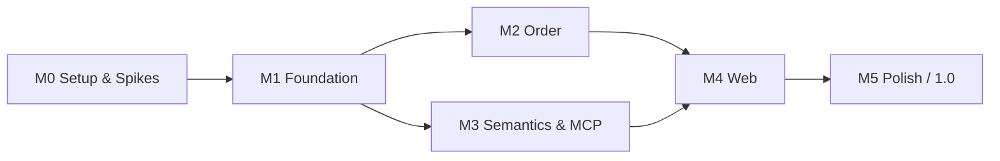

# Roadmap: `shelf`

| | |
|---|---|
| **Based on** | [PRD v1.0](prd.md) |
| **Status** | Draft |
| **Date** | 2026-10-12 |

---

## 1. Overview

The roadmap follows the milestones from PRD chapter 11 and adds a preparatory phase **M0**. M0 front-loads the technical spikes, so that risky decisions (Native AOT, native dependencies) are settled before feature work starts.

Each milestone ends with a usable state and a tagged pre-release.

| Phase | Goal | Pre-release | Acceptance criteria (PRD 12) |
|---|---|---|---|
| **M0 – Setup & Spikes** | Solution skeleton, CI, technical risks settled | – | – |
| **M1 – Foundation** | Import, grouping, full-text search via CLI | `v0.1.0` | 1, 3 |
| **M2 – Order** | Sorted, tagged library, exact duplicates | `v0.2.0` | 2 |
| **M3 – Semantics & MCP** | Semantic search, AI assistant access | `v0.3.0` | 4, 6 |
| **M4 – Web** | Web UI with reader | `v0.4.0` | 5 |
| **M5 – Polish** | Should items, release pipeline | `v1.0.0` | 7 (complete) |

M2 and M3 depend only on M1 and could be swapped or interleaved. M4 needs both, because the web UI covers tags, duplicates, and semantic search.

## 2. Development Process: BDD with Reqnroll

All features are developed behavior-driven with **Reqnroll**: feature files with examples come first, implementation second, and all scenarios must be green afterwards. The detailed rules are in [`CLAUDE.md`](../CLAUDE.md).

For the roadmap this means: M0 sets up Reqnroll and CI, and every milestone's exit criteria include a green BDD suite. CI blocks merges with failing scenarios.

## 3. Milestones

### M0 – Setup & Spikes

**Goal:** All technology decisions that are expensive to revise later are verified.

**Status: closed on 2026-10-17 with known gaps** (see "Carried over from M0" below). The prototypes of the spikes were deleted at the close; each ADR names the last commit that contains them (`f6089e6`).

| Work package | Details | PRD reference |
|---|---|---|
| Solution skeleton | Projects as in 10.1, central package management, `Directory.Build.props`, nullable + warnings as errors | 10.1 |
| CI | Build + test for `osx-arm64` and `linux-x64`; AOT publish as a CI job | 9.2 |
| BDD setup | Reqnroll test project `tests/Shelf.Specs`, choice of test runner, CI runs all scenarios and fails on red ones; first feature file as a template | `CLAUDE.md` |
| License and maintenance check | All candidates from 10.2; result documented as an ADR. **Done:** [ADR 0001](adr/0001-dependency-licenses-and-maintenance.md) | 10.2 |
| **AOT spike** | One AOT binary that loads and uses: Microsoft.Data.Sqlite + FTS5, sqlite-vec, VersOne.Epub, PdfPig, ONNX Runtime, ModelContextProtocol SDK, ASP.NET Core Minimal APIs (JSON API, range requests, embedded Svelte build, access token), TOML parser. `osx-x64` and `linux-arm64` are not supported, so the `osx-x64` decision for ONNX Runtime (PRD 13.2 Q8) no longer applies. **Progress:** storage part (Microsoft.Data.Sqlite + FTS5, sqlite-vec / brute-force fallback) measured on `osx-arm64`: [ADR 0004](adr/0004-storage-sqlite-fts5-vector-search.md); confirmed on `linux-x64` too (all gates pass in the non-required `spike-storage` workflow, PR #15); parser part (VersOne.Epub 3.3.6, PdfPig 0.1.16) measured on `osx-arm64`: all gates pass; confirmed on `linux-x64` too (E2/P2 pass in the non-required `spike-parsers` workflow, PR #15) ([ADR 0005](adr/0005-epub-pdf-parsers-aot.md)); MCP part (ModelContextProtocol.Core 2.2.0, stdio server with tools and resources) passes all gates on `osx-arm64` only, `linux-x64` not verified, `mcp.readOnly` left to M3 ([ADR 0006](adr/0006-mcp-sdk-aot.md)); web part (ASP.NET Core Minimal APIs, runtime OpenAPI, embedded Svelte build, access token) passes all gates on `osx-arm64` only, `linux-x64` not verified ([ADR 0007](adr/0007-web-backend-aot.md)); combined binary (all of the above in one AOT executable) passes all gates on `osx-arm64` only, `linux-x64` not verified ([ADR 0008](adr/0008-combined-aot-binary.md)); ONNX Runtime has no spike (plan rejected, open; ADR 0001 row 11 still `pending`) | Q1, Q2, risk "Native AOT" |
| PDF cover rendering spike | Own slice `m0-spike-pdf-cover`: PDFtoImage 5.4.0 + SkiaSharp + PDFium natives per RID under Native AOT (ADR 0001 rows 6/7, risk row in [ADR 0005](adr/0005-epub-pdf-parsers-aot.md)). **Done on `osx-arm64`:** [ADR 0010](adr/0010-pdf-cover-rendering-aot.md) (all gates pass, also inside the combined binary; `linux-x64` not verified; the cover format for PDFs is JPEG q85, decided by the owner); F-IMP-5 stays in M4 | F-IMP-5, 9.2, G7 |
| CLI framework decision | Spectre.Console.Cli vs. System.CommandLine, decided by AOT compatibility and cold start. **Done:** [ADR 0002](adr/0002-cli-framework.md) (System.CommandLine 2.0.12) | 10.2, 7.1 |
| Cold start measurement | Baseline of the spike binary against the < 150 ms target | 9.1 |
| Test fixtures | Public-domain EPUBs/PDFs; generator for a synthetic library of 10,000 works / 15,000 files for performance tests. **Done:** 13 fixtures in `tests/fixtures/` (manifest + provenance), deterministic generator `tests/Shelf.TestData` ([slice plan](slices/m0-fixtures.md)); reference run not in CI | 10.1, 9.1 |
| Logging | Microsoft.Extensions.Logging to stderr only. **Done:** custom stderr `ILoggerProvider` on Microsoft.Extensions.Logging 10.0.12 ([slice plan](slices/m0-logging.md)); no user-facing level control yet | 10.2 |

**Exit criteria:**

- The AOT spike runs on both supported platforms (`osx-arm64`, `linux-x64`), or every incompatible library has a documented fallback (ReadyToRun, brute-force cosine instead of sqlite-vec). **Partly met.** `osx-arm64`: every library of the spike passes under Native AOT, alone and in one binary ([ADR 0004](adr/0004-storage-sqlite-fts5-vector-search.md), [0005](adr/0005-epub-pdf-parsers-aot.md), [0006](adr/0006-mcp-sdk-aot.md), [0007](adr/0007-web-backend-aot.md), [0008](adr/0008-combined-aot-binary.md), [0010](adr/0010-pdf-cover-rendering-aot.md)); no fallback was needed. `linux-x64`: storage, parsers and TOML pass; MCP, web, the combined binary and PDF cover rendering are not verified. ONNX Runtime had no spike. The gaps are carried over below.
- CLI framework and TOML parser are chosen. **Done:** CLI framework: [ADR 0002](adr/0002-cli-framework.md) (System.CommandLine 2.0.12); TOML parser: [ADR 0003](adr/0003-toml-parser.md) (CsToml 1.8.6; AOT verified on `osx-arm64` and `linux-x64`, see ADR 0003).
- Reqnroll runs in CI; the template feature file is green. **Done:** `tests/Shelf.Specs` runs in the CI `test` job (`dotnet test`) on both platforms.

**Decisions made in M0** (ADR 0001 to 0010): dependency licenses and maintenance (0001, 0009); System.CommandLine (0002); CsToml (0003); SQLite + FTS5 with sqlite-vec loaded from a side file (0004); VersOne.Epub and PdfPig (0005); ModelContextProtocol.Core with explicit registration (0006); Minimal APIs on Kestrel with runtime OpenAPI, embedded Svelte build and bearer token (0007); one Native AOT executable for everything (0008); Node.js 26 for the UI build (0009); PDFtoImage for covers, PDF cover as JPEG q85 at 600 px (0010). Svelte instead of htmx + RazorSlices is recorded in PRD Q1.

#### Carried over from M0

| Gap | Lands in | Note |
|---|---|---|
| ONNX Runtime and the XLM-R tokenizer under Native AOT (managed and native part, token-ID parity) | first slice of M3 (`m3-semantic-core`, as a gate, no spike) | **Done in M3 slice 1 on `osx-arm64`:** token-ID parity and an AOT run pass, row 11 is `adopt` ([ADR 0013](adr/0013-onnx-tokenizer-aot.md)); `linux-x64` is checked by the `aot` job since `m3-close` |
| `linux-x64` verification of MCP, web, the combined binary and PDF cover rendering | first CI job that publishes the real `shelf` binary on `linux-x64` (M1 for the CLI parts, M3 for MCP, M4 for web and covers) | **CLI parts done in M1 and M2:** the `aot` job publishes the real `shelf` on `linux-x64` and runs `tests/e2e/native.sh` (M1 and M2 commands); **MCP added in M3**; **web, covers and the interface added in M4** (`native.sh` starts `shelf serve` from a reduced `PATH` and checks the API, range requests, the cover, the page and its policy, the token and the cookie, a bind that is refused). The first CI run on `linux-x64` of everything since M3 (ONNX Runtime, MCP, web, PDFium and SkiaSharp natives, Chromium for the browser scenarios) is still pending |
| Cold start of the real commands against < 150 ms | M1 exit criteria (performance) | **Done in M1:** 30 ms for `--version` on `osx-arm64` ([ADR 0011](adr/0011-m1-performance.md)) |
| Project setup for the executable: Web SDK or `MvcEnhancedModelMetadataSupport=false` with the runtime feature switch and the `<Using>` items; `CA1416` handling (assembly-level `SupportedOSPlatform`) with warnings as errors | **Done in M4:** the feature switch is in `Shelf.Cli.csproj`; `Shelf.Web` has the `<Using>` items and two more settings that ADR 0008 did not name (`EnableRequestDelegateGenerator`, `InterceptorsNamespaces`); `CA1416` is handled with a `#pragma` at the two PDFtoImage call sites (an attribute on the class or the assembly only moves the warning to the callers) | [ADR 0008](adr/0008-combined-aot-binary.md) findings 1 and 2, [ADR 0010](adr/0010-pdf-cover-rendering-aot.md) finding 2, [ADR 0017](adr/0017-m4-web-measurements.md) |
| UI build in CI: `actions/setup-node` with Node.js 26, `npm ci`, a type-check step, `allowScripts` decision for fsevents; negation in the root `.gitignore` for `package.json` and `package-lock.json` | **Done in M4** (slice 6): `setup-node` from `.node-version`, `npm ci`, `svelte-check` in the `test`, `aot` and `perf` jobs; `ignore-scripts` instead of `allowScripts`; the negation is in `src/Shelf.Web.Ui/.gitignore`. TypeScript 6.0.3 replaces 7.0.2 because `svelte-check` does not take 7 (addendum to ADR 0009) | [ADR 0009](adr/0009-frontend-toolchain-licenses-and-maintenance.md) |
| `mcp.readOnly` (hiding write tools), one error format for `/api/v1`, OpenAPI path and token flow in the browser | **Done:** `mcp.read_only` in M3; in M4 one error format (`application/problem+json` with `status`, `title`, `detail`), the OpenAPI document at `/api/v1/openapi.json` (behind the token), and the token flow in the browser (`?token=` sets an HttpOnly, SameSite=Strict cookie and redirects to the address without the token) | [ADR 0006](adr/0006-mcp-sdk-aot.md), [ADR 0007](adr/0007-web-backend-aot.md) |
| Signature and quarantine of the native libraries on macOS (`vec0`, `libpdfium`, `libSkiaSharp`) | M5 distribution | [ADR 0004](adr/0004-storage-sqlite-fts5-vector-search.md) R5, [ADR 0010](adr/0010-pdf-cover-rendering-aot.md) R5 |
| `THIRD-PARTY-NOTICES` (PDFium, SkiaSharp, the Svelte runtime, PDF.js and its data files (Foxit and Liberation fonts, OpenJPEG, JBIG2, qcms, cmaps), foliate-js with its zip.js and fflate); the license of the Liberation fonts is to be confirmed, with the option to leave them out | M5 distribution | [ADR 0016](adr/0016-reader-libraries.md) addendum, [ADR 0009](adr/0009-frontend-toolchain-licenses-and-maintenance.md) |
| The integrated CsToml adapter in `Shelf.Core` published on `linux-x64` | **Done in M1:** the `aot` job publishes the integrated adapter on `linux-x64` and the end-to-end check reads a config | only the prototype was published there ([ADR 0003](adr/0003-toml-parser.md)) |

### M1 – Foundation

**Status: closed 2026-10-18, pre-release `v0.1.0`.** Slice plans: `docs/slices/m1-*.md`; performance: [ADR 0011](adr/0011-m1-performance.md).

**Goal:** A library can be created, imported, grouped, and searched via the CLI.

| Area | Must | Should |
|---|---|---|
| Library and data model | F-LIB-1, F-LIB-2, F-LIB-4, F-LIB-5, F-LIB-6, F-LIB-7 | F-LIB-3 |
| Import and extraction | F-IMP-1, F-IMP-2, F-IMP-3 | F-IMP-4, F-IMP-7 |
| Grouping | F-GRP-1, F-GRP-2, F-GRP-3, F-GRP-4, F-GRP-6 | – |
| Search | F-SRC-1, F-SRC-2, F-SRC-3, F-SRC-5 | – |
| Configuration | Global and per-library `config.toml` (9.2) | – |

**CLI commands:** `init`, `import`, `scan`, `reindex`, `search`, `show`, `edit`, `merge`, `split`, `review`, `open`, `stats`. All with `--json`, exit codes 0/1/2, `NO_COLOR` (7.1).

**Notes:**

- The review queue (`.shelf/review.json`, F-IMP-7) is needed as early as M1, because F-GRP-3 (Must) creates review entries.
- `book.json` already uses the final schema from 10.4, including `files[].progress` and `notDuplicates`, so that no schema migration is needed later.
- The grouping thresholds (F-GRP-6) are calibrated against acceptance criterion 1 before M1 is closed.

**Exit criteria:**

- Feature files exist for all M1 requirements, and all BDD scenarios are green.
- Acceptance criteria 1 and 3 are met.
- Performance on the synthetic library: search p95 < 100 ms, incremental scan without changes < 3 s, initial indexing < 15 min, cold start < 150 ms.

**Result:** all exit criteria met. BDD green (1321 tests). Acceptance 1: 99-100 of 100 pairs merged, no wrong merge (`Calibration.feature`); acceptance 3: `reindex` restores everything from the sidecars. Performance on `osx-arm64`, reference library of 10,000 works / 15,000 files: cold start 30 ms, scan 0.9 s, initial index 0.9 min, search p95 98 ms for typical queries (176 ms for words in nearly every passage; see ADR 0011). F-LIB-3 stays out of M1. Not yet run on shared `linux-x64` runners: `perf.yml` does that on `main`.

### M2 – Order

**Status: closed 2026-10-18, pre-release `v0.2.0`.** Slice plans: `docs/slices/m2-*.md`; decisions: [ADR 0012](adr/0012-m2-journal-trash-and-pattern.md).

**Goal:** The library is sorted by pattern, tagged, and free of exact duplicates.

| Area | Must | Should |
|---|---|---|
| Organization | F-ORG-1 to F-ORG-7 | F-ORG-8 |
| Tags | F-TAG-1 to F-TAG-5 | – |
| Duplicates | F-DUP-1, F-DUP-2, F-DUP-4, F-DUP-5 (CLI part) | F-DUP-6 |
| Grouping | – | F-GRP-5 |

**CLI commands:** `organize`, `undo`, `tag add|rm|list|rename|merge`, `dupes [--interactive]`, `trash empty`.

**Notes:**

- The journal (F-ORG-6) is used for all file operations, including moving files to the trash, so that crash recovery works (9.3).

**Exit criteria:**

- Feature files exist for all M2 requirements, and all BDD scenarios are green.
- Acceptance criterion 2 is met (organize + undo verified by hash comparison).
- No collision ever overwrites a file (F-ORG-7), covered by tests.

**Result:** all exit criteria met. Must items F-ORG-1 to F-ORG-7, F-TAG-1 to F-TAG-5, F-DUP-1, F-DUP-2, F-DUP-4 and F-DUP-5 (CLI), and the Should items F-ORG-8, F-DUP-6 and F-GRP-5 are implemented. BDD and unit tests green (1500+ tests). Acceptance 2: `organize --apply` and `undo` give back the same files and folders by SHA-256 (`Undo.feature`, and `tests/e2e/native.sh` with the native binary). Collisions: `Organize.feature`, `JournalTests`. Performance of the new commands on the reference library: `organize` dry run 0.47 s, `dupes` 0.29 s (ADR 0012). Not yet run: the `linux-x64` perf job on `main`. Known limits: `merge`, `split`, `edit` and the import are not undoable; journals older than the newest 50 are deleted; a case-only rename on a case-insensitive file system is reported as a collision.

### M3 – Semantics & MCP

**Goal:** Semantic search runs locally, and an AI assistant can use the library via MCP.

| Area | Must | Should |
|---|---|---|
| Semantic search | F-SEM-1, F-SEM-2, F-SEM-3, F-SEM-4, F-SEM-7 | F-SEM-5, F-SEM-8 |
| Model handling | Model download to `.shelf/models/`, `shelf model install <path>` (9.2) | – |
| MCP server | stdio transport, tools `search_books`, `semantic_search`, `get_book`, `read_passage`, `list_tags`, `add_tags`, `remove_tags`, `find_duplicates`, `propose_organization`; resources `shelf://book/{id}` and `shelf://book/{id}/toc`; `mcp.readOnly` (7.2) | – |

**CLI commands:** `semantic`, `reindex --embeddings`, `model install`, `mcp`.

**Notes:**

- Embeddings are indexed at work level first, chunks afterwards (risk "Initial embedding indexing takes long").
- sqlite-vec is adopted ([ADR 0004](adr/0004-storage-sqlite-fts5-vector-search.md)). The brute-force cosine fallback in C# is used only when `vec0` cannot be loaded.
- **No separate ONNX spike.** The gap carried over from M0 (ONNX Runtime and the XLM-R tokenizer under Native AOT) is a gate in the first slice: token-ID parity against reference IDs and an AOT publish on `osx-arm64`. If the gate fails, `Shelf.Semantic` falls back to ReadyToRun (PRD 9.2), recorded in an ADR. Speed, quantization and model comparisons are not measured up front; they are measured once, at the end (slice 9), against the exit criteria.
- Chunks for embeddings get an overlap (F-SEM-2); the FTS chunks stay as they are.
- The chunk-level budget at 1.5-2.5 million chunks is open ([ADR 0004](adr/0004-storage-sqlite-fts5-vector-search.md)): quantization, larger chunks or an in-memory index are decided in slice 9 after measuring.

**Slices** (plans in `docs/slices/m3-*.md`, feature files first, stacked branches `feat/m3-*`):

| # | Slice | Content | Requirements |
|---|---|---|---|
| 1 | `m3-semantic-core` (done) | `Shelf.Semantic`: tokenizer, ONNX session, mean pooling, L2 norm, E5 prefixes, `IEmbedder` with a fake for BDD; AOT gate; ADR 0013, ADR 0001 row 11 | F-SEM-1 |
| 2 | `m3-model` (done) | `model install <path>`, download on first need (pinned URL + SHA-256), `[semantic]` config | F-SEM-1, 9.2 |
| 3 | `m3-vector-store` (done) | `vec_works` / `vec_chunks` (cosine), `vec0` loading with brute-force fallback, pinned fetch, model and dimension metadata | F-SEM-4 |
| 4 | `m3-embedding-index` (done) | Work level first, then chunks; `embed_status`, batching, interrupt and resume, progress, `reindex --embeddings`, hook in `import` / `scan` | F-SEM-2, F-SEM-3, F-SEM-7 |
| 5 | `m3-semantic-search` (done) | `semantic [--chunks] [--json]`, locations, cross-language, incomplete-index notice | F-SEM-1 to 3, AC 4 |
| 6 | `m3-hybrid` (done) | RRF of FTS and vectors; model change re-indexes | F-SEM-5, F-SEM-8 |
| 7 | `m3-mcp-core` (done) | `shelf mcp` (stdio), read tools, resources, clean stdout, error scenarios from ADR 0006 | 7.2, AC 6 |
| 8 | `m3-mcp-semantic-write` (done) | `semantic_search`, `add_tags` / `remove_tags`, `mcp.readOnly`, stdio protocol e2e | 7.2, AC 4, AC 6 |
| 9 | `m3-close` (done) | Native e2e for M3 (incl. `linux-x64` in the `aot` job), measurements on the reference library, ADR 0014, status | exit criteria |

Order: 1 → 2 → 3 → 4 → 5 → 6. Slice 7 can start after 3 and run in parallel to 4-6. Slice 8 needs 5. Slice 9 is last.

**Exit criteria:**

- Feature files exist for all M3 requirements, and all BDD scenarios are green.
- Acceptance criteria 4 and 6 are met.
- Semantic search p95: work level < 300 ms, chunk level < 800 ms.
- Initial embedding indexing of the synthetic library < 6 h and resumable.

**Status:** done, pending the tag `v0.3.0` (owner) and the first CI run of the `linux-x64` parts.

**Result:** all exit criteria met, with one reading to confirm. Must items F-SEM-1 to F-SEM-4 and F-SEM-7, Should items F-SEM-5 and F-SEM-8, `model install`, and the MCP server with nine tools, two resources and `mcp.read_only` are implemented. AC 4 and AC 6 pass with the real model (`McpAcceptance`, `SemanticSearch`; `native.sh` with the native binary). Semantic p95 in a running server: work 7 ms, chunk 14 ms at 12,000 chunks; `vec0` nearest neighbors at 430,000 chunk vectors 170 ms. A one-shot `shelf semantic` takes 0.47 s (model load), so the 300 ms target is read as a target for a running process (ADR 0014; owner to confirm). Initial embedding: 56 passages per second, 2.1 h for the reference library by extrapolation (goal < 6 h); interrupt and resume tested. Not yet run: `linux-x64` (ONNX Runtime, MCP) in the `aot` job; the full embedding of the 10,000-work library. Known limits: `reindex` drops the embeddings (`reindex --embeddings` refills them); the work embedding does not use the table of contents; config changes need a restart of `shelf mcp`.

### M4 – Web

**Goal:** The library can be searched, browsed, and read in the browser.

| Area | Must | Should |
|---|---|---|
| Web API | REST/JSON under `/api/v1`, file delivery with range requests, OpenAPI (7.3) | – |
| General | F-WEB-1, F-WEB-2, F-WEB-3, F-WEB-4 | – |
| Views | Library, Search, Work details, Duplicates (F-DUP-5 web part) | – |
| Reader | F-RDR-1, F-RDR-2, F-RDR-3 | – |
| Extraction | – | F-IMP-5 (covers, needed for the library grid) |

**CLI commands:** `serve`.

**Notes:**

- The UI is a Svelte single-page application (PRD Q1, decided 2026-10-17). CI and local builds need a pinned Node.js version for the UI build; the runtime needs none.
- F-IMP-5 is pulled into M4 because the library grid needs covers. The PDF cover rendering adds PDFium as another native dependency per platform.

**Exit criteria:**

- Feature files exist for all M4 requirements, and all BDD scenarios are green.
- Acceptance criterion 5 is met.
- Library view loads in < 500 ms; idle RAM of `serve` < 200 MB.

**Status:** done, pending the tag `v0.4.0` (owner) and the first CI run of the `linux-x64` parts.

**Result:** all exit criteria met. Must items F-WEB-1 to F-WEB-4, F-RDR-1 to F-RDR-3, the views Library, Search, Work details and Duplicates, the web API with range requests and OpenAPI, and the Should item F-IMP-5 are implemented. AC 5 is a browser scenario and passes. The library view takes 33 ms (p95, API with page) and 97 ms to the first list in Chromium on the reference library; idle RAM of `serve` is 41.5 MB (88 MB after the requests); `shelf covers` for 8,336 covers takes 76 s ([ADR 0017](adr/0017-m4-web-measurements.md)). Not yet run: `linux-x64` in the `aot` job. Known limits: file IDs change when `organize` renames a file; `ignore` marks a whole duplicate group; no `web.read_only`; the PDF.js data holds four Liberation fonts under GPL-2 with the font exception (owner decision pending, ADR 0016).

### M5 – Polish

**Goal:** All remaining Should items are done and release 1.0 is published.

| Area | Should |
|---|---|
| Duplicates | F-DUP-3 (probable duplicates, cosine threshold calibrated), F-DUP-7 (delete a file or a work: `shelf delete`, work details) |
| Semantic search | F-SEM-6 (similar books) + MCP tool `similar_books` |
| Search | F-SRC-4 (fuzzy search), F-SRC-6 (stemming DE/EN) |
| Reader | F-RDR-4 (reading progress), F-RDR-5 (preferred format) |
| Web | Views Tags, Review, Organize; F-WEB-5 (keyboard control) |
| MCP | Streamable HTTP transport |
| CLI | Shell completion for bash, zsh, fish |
| Distribution | GitHub Releases for both platforms (`osx-arm64`, `linux-x64`), Homebrew tap |

**Exit criteria:**

- Feature files exist for all M5 requirements, and the complete BDD suite is green.
- Acceptance criterion 7: all performance targets from 9.1 are met on the reference hardware.
- All Must and Should requirements are implemented.

### M6 – Annotations

**Goal:** Highlights and Markdown notes while reading, in the web UI, the CLI and MCP.

**Status:** implemented on `feat/annotations`; slice plan: [m6-annotations](slices/m6-annotations.md), decisions: [ADR 0018](adr/0018-annotations.md).

| Area | Content | PRD |
|---|---|---|
| Storage | `annotations.json` per work, index mirror with full text, follows organize/merge/split | F-ANN-3 |
| Web API | `/api/v1/files/{id}/annotations`, `/api/v1/works/{id}/annotations` | F-ANN-3 |
| Reader | EPUB and PDF highlights, notes panel with Markdown, notes on the book page | F-ANN-1, F-ANN-2, F-ANN-4 |
| Search, CLI, MCP | search hits, `shelf notes`, `get_annotations`, `add_note` | F-ANN-5, F-ANN-6 |
| Export | one Markdown file per work (metadata, highlights, notes) named after the cite key: `shelf notes export`, work page, `/api/v1/works/{id}/export.md` | F-ANN-7 |

**Exit criteria:** feature files exist for all F-ANN requirements, the complete BDD suite is green, `shelf reindex` restores the mirror from the files, the CSP is unchanged.

### M7 – Work Files by Hand

**Goal:** New versions of a book, files in the wrong work, and works without an import can be handled by hand, in the CLI and the web UI.

**Status:** planned; slice plan: [m7-work-files](slices/m7-work-files.md).

| Area | Content | PRD |
|---|---|---|
| Add / replace | `shelf add`, upload in the work details, old file to the trash on `--replace` | F-GRP-7 |
| Move | `shelf move`, move button in the work details, undoable | F-GRP-8 |
| Create | `shelf create`, "New work" in the library view | F-GRP-9 |
| Web API | `POST /works`, `POST /works/{id}/files`, `POST /files/{id}/move` | F-GRP-7 to F-GRP-9 |

**Exit criteria:** feature files exist for F-GRP-7 to F-GRP-9, the complete BDD suite is green, `shelf reindex` after each operation gives the same index.

### M8 – Paged Library

**Goal:** A large library can be browsed page by page in the web UI: page count, jump to a page, choose how many works a page holds.

**Status:** planned.

| Area | Content | PRD |
|---|---|---|
| Library view | page numbers with gaps, "Page x of y", previous / next, works per page (20, 40, 60, 80, 100), state in the address | F-WEB-6 |

**Exit criteria:** feature file `UiLibraryPaging.feature` exists, the complete BDD suite is green, the web API is unchanged.

### M9 – Papers

**Goal:** Scientific papers are imported, identified by DOI or arXiv ID, enriched online and exported as BibTeX.

**Status:** done (merged); feature files in `tests/Shelf.Specs/Features/Papers/`. Done: F-PAP-1 to F-PAP-5 (CLI, REST, library and book view, MCP), F-PAP-7 (filters, abstract in the full-text index and in the work embedding), F-PAP-8 (CLI, REST, library view), F-PAP-6 (CLI), F-PAP-9, F-PAP-10. F-PAP-8 also asks Unpaywall.

| Area | Content | PRD |
|---|---|---|
| Data model | `kind`, DOI, arXiv ID, PMID, venue, abstract, keywords in `book.json` | F-PAP-1 |
| Import | DOI and arXiv ID detection, `kind: paper` | F-PAP-2 |
| Enrich | Crossref and arXiv API, same preview / apply flow as books | F-PAP-3 |
| Citations | cite key generation, BibTeX / CSL-JSON / RIS export, BibTeX import | F-PAP-4 to F-PAP-6 |
| Search | `type:`, `doi:`, `arxiv:`, `venue:`, abstract in index and embeddings | F-PAP-7 |
| Fetch, grouping, layout | `shelf fetch <doi>`, DOI first in the cascade, pattern per kind | F-PAP-8 to F-PAP-10 |

**Exit criteria:** feature files exist for all F-PAP requirements, the complete BDD suite is green, `shelf reindex` restores the paper fields from the sidecars.

### M10 – Bookmarks and Tag Suggestions

**Goal:** Places in a book are kept without marking text, and a work gets tag suggestions from the works most like it.

**Status:** implemented. Slice plans: [m10-bookmarks](slices/m10-bookmarks.md), [m10-tag-suggestions](slices/m10-tag-suggestions.md).

| Area | Content | PRD |
|---|---|---|
| Bookmarks | third annotation kind in `annotations.json`, reader button, notes panel and work page, `shelf notes bookmark`, Markdown export, MCP `add_bookmark` | F-RDR-6 |
| Tag suggestions | tags of the 10 most similar works as suggestions: `shelf tag suggest`, `GET /works/{id}/tag-suggestions`, MCP `suggest_tags`, chips on the work page | F-TAG-6 |

**Exit criteria:** feature files exist for F-RDR-6 and F-TAG-6, the complete BDD suite is green, `shelf reindex` restores the bookmarks, suggestions need no model.

### M11 – Cite and References

**Goal:** A passage is quoted with the right citation, and a paper knows which of the works it cites are in the library.

**Status:** implemented. Slice plans: [m11-cite-passage](slices/m11-cite-passage.md), [m11-references](slices/m11-references.md); decisions: [ADR 0019](adr/0019-references.md).

| Area | Content | PRD |
|---|---|---|
| Cite a passage | "Copy as quote" in both readers, `shelf cite`, `POST /files/{id}/quote`, MCP `cite_passage`; Markdown block quote plus Pandoc citation with the place | F-ANN-8 |
| References | `references.json` from Crossref on `shelf refs fetch`; cited works in the library and the works that cite a paper: `shelf refs list`, `GET /works/{id}/references`, tab "References", MCP `get_references` | F-PAP-11, F-PAP-12 |

**Exit criteria:** feature files exist for all M11 requirements, the complete BDD suite is green.

## 4. Backlog After 1.0

Could items and deferred decisions:

| Item | PRD reference |
|---|---|
| Watch mode | F-LIB-8 |
| Import from cloud folders via rclone (Google Drive and others) | F-IMP-8 |
| Evaluation of bge-m3 as an alternative embedding model | Q3 |
| Distribution as `dotnet tool` | 9.2 |

## 5. Cross-Cutting Topics

These run through all milestones and are not tied to a single phase:

- **Performance tests:** Benchmarks against the synthetic library run in CI from M1 on, so that regressions show up early.
- **Data safety:** Every new file operation goes through the journal (9.3) and gets a crash test.
- **`book.json` compatibility:** The `schema` field is incremented on every breaking change; older sidecars are migrated on read.
- **`--json` output:** Every new CLI command gets JSON output and a test for it.
